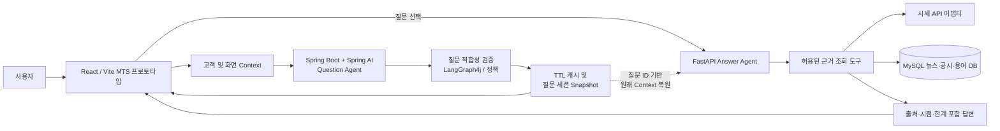

# All in WON

### 증권 MTS의 화면과 고객 맥락을 이해하고, 필요한 질문을 먼저 제안하는 AI Agent PoC

> **프로젝트 성격:** 우리 WON 청년 IT 아카데미 3일 AX 해커톤에서 기획·개발한 **팀 프로토타입(Proof of Concept)**  
> **핵심 아이디어:** 고객이 AI 메뉴를 찾거나 질문을 직접 작성하기 전에, **현재 확인하는 종목·화면 정보와 선택한 금융 이해도**를 바탕으로 질문을 추천합니다.  
> **목표:** 새로운 투자분석 모델을 추가하기보다는 기존 투자정보·AI 기능으로 진입하는 경험을 개선하는 것.

**[라이브 데모: 공개 URL 확인 후 연결] · [시연 영상: 링크 추가 예정] · [발표자료: 링크 추가 예정]**

> **고지:** All in WON은 교육 목적의 독립적인 PoC입니다. 우리투자증권 또는 우리금융그룹의 공식 운영 서비스가 아니며, 실제 고객계좌·주문 시스템·사내 AI Agent에 연결된 상용 상품이 아닙니다. 종목 화면 및 브랜드 관련 요소는 서비스 적용 가능성을 설명하기 위한 시연 자료이며, 공개 권한 및 상표·이미지 사용 범위는 별도로 확인해야 합니다.

---

## 목차

1. [프로젝트 배경](#1-프로젝트-배경)
2. [해결 방식과 서비스 차별점](#2-해결-방식과-서비스-차별점)
3. [사용자 경험과 주요 기능](#3-사용자-경험과-주요-기능)
4. [시스템 아키텍처](#4-시스템-아키텍처)
5. [데이터·AI 설계 원칙](#5-데이터ai-설계-원칙)
6. [보안 및 금융 소비자 보호](#6-보안-및-금융-소비자-보호)
7. [구현·검증 범위와 한계](#7-구현검증-범위와-한계)
8. [실행 및 시연 가이드](#8-실행-및-시연-가이드)
9. [사업적 적용 가능성과 성과 지표](#9-사업적-적용-가능성과-성과-지표)
10. [확장 로드맵](#10-확장-로드맵)
11. [자료·연락·라이선스](#11-자료연락라이선스)

---

## 1. 프로젝트 배경

### 금융 AI의 다음 과제는 ‘기능을 만드는 것’뿐 아니라 ‘고객이 쓰게 하는 것’

증권 MTS에는 차트 분석, 리서치, 뉴스·공시 해석, 기술지표 등 다양한 정보와 AI 기능이 제공됩니다. 그러나 고객이 정보를 확인하는 흐름 속에서 **어떤 AI 기능을 언제 사용해야 하는지, 무엇을 질문해야 하는지**는 여전히 장벽이 될 수 있습니다.

팀은 다음과 같은 고객 경험에 주목했습니다.

| 사용자 유형 | 앱을 이용하면서 겪는 상황 | 필요한 도움 |
|---|---|---|
| **금융정보를 배우는 사용자** | 주가나 뉴스를 보지만 PER·선행지표 등 용어가 어렵고 질문을 만들기 힘듦 | 상황에 맞는 쉬운 질문과 짧은 설명 |
| **직접 분석하는 사용자** | 여러 화면과 근거 자료를 확인할 수 있지만 AI를 별도로 사용할 이유가 작음 | 현재 종목과 이슈에 관련된 깊이 있는 질문·근거 연결 |

따라서 이 프로젝트의 문제 정의는 **“새로운 금융 AI 기능이 부족하다”**가 아니라, **“고객의 평소 투자 탐색 과정과 AI 이용이 자연스럽게 연결되지 않는다”**입니다.

목표는 투자 판단을 대신하는 것이 아니라, 고객이 현재 보고 있는 정보를 이해하도록 돕고 필요한 경우 기존 전문 기능을 발견하도록 만드는 것입니다.

## 2. 해결 방식과 서비스 차별점

All in WON은 **질문 역설계(Question Reverse Engineering)** 방식을 제안합니다. 사용자가 AI를 먼저 호출하는 대신, 서비스가 현재 맥락에서 도움이 될 만한 질문을 먼저 생성합니다.

| 구분 | 기존 챗봇 중심 접근 | All in WON의 PoC 접근 |
|---|---|---|
| 서비스 시작 | 사용자가 AI 기능/입력창을 찾음 | 종목 상세 화면에서 질문이 제안됨 |
| 맥락 전달 | 사용자가 종목과 내용을 직접 설명하는 경우가 많음 | 종목·화면·콘텐츠 정보를 입력 맥락으로 구성 |
| 질문 작성 | 사용자가 질문을 구상 | AI가 질문 후보를 먼저 생성 |
| 금융 이해도 | 동일한 표현이 항상 적합하지 않음 | `쉽게` / `깊게` 또는 `BASIC` / `DETAILED` 선택 |
| 답변 | 텍스트 생성에 치우칠 수 있음 | 필요한 경우 가격·뉴스·공시·용어 근거를 조회하는 구조 |
| 확장 방향 | 개별 AI 서비스 중심 | 기존 투자·금융 AI를 연결하는 맥락 인식 계층 |

> **AI 활용의 근거:** 화면마다 미리 정한 질문을 보여주는 일은 규칙 기반으로도 가능합니다. 이 PoC가 LLM을 선택한 이유는 **종목, 현재 표시된 콘텐츠, 고객의 이해도·보유 여부 등 복합적인 맥락을 조합해 질문의 내용과 우선순위를 바꾸기 위해서**입니다. 규칙과 캐시로 처리 가능한 부분까지 모두 모델에 맡기는 구조는 지양합니다.

## 3. 사용자 경험과 주요 기능

### 3.1 화면 맥락에 따라 달라지는 질문

하나의 종목 화면 안에서 차트 → 뉴스/공시 → 선행·후행지표 → 배당정보를 확인할 때 관련 질문이 달라지는 것을 중심 경험으로 설계했습니다. AI 추천 질문은 하단의 짧은 카드로 노출해 기존 탐색 흐름을 크게 방해하지 않도록 합니다.

| 종목 화면 | 질문에 사용하는 대표 Context | 시연용 질문 예시 |
|---|---|---|
| 차트 | 종목코드, 가격·거래량, 조회 기간 | “최근 가격 변동에서 함께 확인할 지표는?” |
| 뉴스 | 기사 ID·제목, 종목, 화면에서 선택된 기사 | “이 뉴스의 핵심 내용은 무엇인가요?” |
| 공시 | 공시 ID·제목, 관련 기업 | “이 공시에서 확인해야 할 사항은?” |
| 선행·후행지표 | 현재 종목, 관련 종목과 지표 | “선행지표는 어떻게 해석하나요?” |
| 배당정보 | 지급 시기, 주당 배당금, 배당수익률 등 | “배당수익률은 어떻게 이해하면 되나요?” |
| AI SCAN | 화면에 표시된 분석 기능의 종류 | “이 분석은 어떤 정보를 보여주나요?” |

**예시 문구는 시연용으로, 실제 가격 움직임·개별 기업 실적 또는 투자 결과를 단정하지 않습니다.** AI SCAN은 기존 전문 기능과 연계할 수 있는 방향을 고려한 화면 요소이며, 실제 사내 AI SCAN API 연동 완료를 의미하지 않습니다.

### 3.2 금융 이해도 선택

- **쉽게/BASIC:** 핵심 요약, 쉬운 금융용어 풀이, 추가로 확인할 정보.
- **깊게/DETAILED:** 근거가 확보된 경우 기간·수치 비교, 관련 자료, 다른 해석과 불확실성.

이해도는 사용자 스스로 선택하며, 연령만으로 수준을 자동 추정하지 않습니다. **수준을 바꿔도 동일한 종목·기사·화면 Context는 유지**하는 것을 원칙으로 설계했습니다.

### 3.3 질문 클릭 후 근거 기반 답변

1. 추천 질문을 선택합니다.
2. 질문 생성 당시의 `session_id`, `question_id` 및 Context Snapshot을 식별합니다.
3. 답변 Agent가 질문 유형과 데이터 소스에 맞는 **읽기 전용 도구**를 이용합니다.
4. 답변은 요약·해설에 더해 출처, 데이터 기준 시각, 근거 부족 여부를 제공하는 구조를 지향합니다.

질문을 미리 보여주기 위한 생성과, 실제 사용자가 요청했을 때만 필요한 근거를 조회하는 답변을 분리해 **불필요한 연산을 줄이도록 설계**했습니다.

### 3.4 우리금융지주 시연 시나리오

앱 진입 및 개인화 정보 이용 동의 화면 → **우리금융지주** 종목 선택 → 차트 관련 질문 확인 → 뉴스/공시로 스크롤 → 공시에 적합한 질문으로 전환 → 쉬운/깊은 질문 선택 → 질문 클릭 및 답변 패널 확인 → 선행지표·배당·AI SCAN 관련 화면 소개.

시연의 중심은 많은 화면을 소개하는 것이 아니라, **한 종목의 연속된 탐색 경험에서 맥락이 유지되는 과정**입니다.

## 4. 시스템 아키텍처

### 4.1 서비스 간 역할

프로젝트 구조 문서에 기록된 PoC 구성을 기준으로 다음과 같이 역할을 분리했습니다.



| 컴포넌트 | 기술 | PoC 설계상 책임 |
|---|---|---|
| Frontend | React + Vite | MTS 유사 UI, 스크롤 영역 인식, 수준 전환, 질문 카드·답변 패널 |
| Question Agent | Java, Spring Boot, Spring AI | Context 정규화, 질문 생성, 질문 후보·세션 관리 |
| 검증·캐시 | LangGraph4j, 정책 검증, Caffeine/TTL | 부적절한 질문 제한, 동일 Context 반복 호출 완화 |
| Answer Agent | Python, FastAPI | 질문 ID 조회, 필요한 도구 선택, 근거 기반 답변 구성 |
| AI 모델 | 개발용 모델 API | 비정형 질문 생성과 자료 기반 설명; 모델 교체 가능성을 고려한 인터페이스 |
| 금융 데이터 | 토스증권 Open API, MySQL | 시세·캔들·뉴스·공시·투자용어 근거 제공 및 관리 |

> 이 표는 **팀의 아키텍처·개발 문서에 기록된 시스템 구성**입니다. Spring–FastAPI 간 최종 HTTP 통합, 실제 증권사 내부 API 및 배포 환경까지 독립 검증됐다는 의미는 아닙니다. 공개 저장소의 코드·테스트가 갖춰지는 대로 구현 상태를 명확히 갱신합니다.

### 4.2 핵심 설계 선택과 트레이드오프

**스크롤마다 모델 호출하지 않기**

- 화면 변화마다 LLM을 호출하면 지연·비용·질문 튐이 발생하기 쉽습니다.
- 같은 종목의 여러 영역/수준별 질문을 준비하고, 이미 준비한 질문은 프론트 상태로 교체하도록 설계했습니다.
- 정보가 갱신되면 캐시 키의 콘텐츠 ID·시각·프롬프트 버전을 반영해 재생성을 검토합니다.

**질문 클릭 시점의 맥락 불일치 방지**

- 고객이 다른 기사로 스크롤한 뒤 과거 질문을 클릭할 수 있습니다.
- 답변 요청은 현재 화면 전체 텍스트를 다시 해석하기보다 **질문/세션 ID를 기준으로 생성 당시의 Snapshot을 복원**하도록 설계했습니다.
- 만료되거나 서로 다른 기사·세션이면 재준비/거부 처리해야 합니다.

**질문 Agent와 답변 Agent를 따로 두기**

- 질문 생성에는 현재 화면·고객 수준의 적합성 판단이 중요하고, 답변에는 증거 조회·기간 비교·금융 설명이 중요합니다.
- 서로 다른 책임을 분리하되, 3일 PoC 단계에서 모든 전문 기능을 독립 Agent로 분할하지 않았습니다.
- 장기적으로 전문 Agent가 증가하면 Supervisor를 통한 단계적 분리가 가능하도록 공통 API 계약을 고려했습니다.

## 5. 데이터·AI 설계 원칙

### 5.1 Context는 화면과 서버에서 결정적으로 구성

- **Customer Context:** 가상 고객의 보유/관심 여부, 사용자가 선택한 이해도 등. 실고객정보 연동과 구별합니다.
- **Page Context:** 현재 종목, 차트 기간, 뉴스·공시 제목과 콘텐츠 ID, 배당·선행지표 등의 화면 정보.
- **Snapshot:** 특정 질문이 어느 시점에 어떤 기사/종목을 바탕으로 만들어졌는지 묶는 식별자.

질문 Agent가 화면에 이미 표시된 제목을 다시 조회하거나, LLM을 단순 Context 수집 목적으로 호출하는 것은 피하도록 설계했습니다.

### 5.2 근거와 생성 모델의 역할 분리

| 근거 종류 | 권장 처리 | 주의 사항 |
|---|---|---|
| 가격·거래량·캔들 | 공식 제공 API 또는 승인된 데이터 공급자에서 조회 | `as_of`, 거래소 시점, 조회 실패·지연 표시 |
| 뉴스·공시 | 콘텐츠 ID와 출처·발행일·제목 관리 | 본문이 없는 경우 내용을 추측하지 않음 |
| 금융용어 | 용어사전에서 정의·쉬운/깊은 해설 조회 | 정의의 출처·개정 시점 관리 |
| 모델 출력 | 요약과 설명의 문장 구성 | 존재하지 않는 수치·URL·주가 원인 생성 금지 |

금융용어사전 설계에는 `term_code`, `aliases`, `easy_explanation`, `deep_explanation`, `source_page` 등의 필드를 두었습니다. 이 정보는 서비스의 응답 일관성과 출처 확인을 지원하기 위한 구조입니다.

### 5.3 금융 AI 품질 기준

- **맥락 적합성:** 제안된 질문은 현재 종목·영역·기사에 부합해야 합니다.
- **근거 충분성:** 확인할 수 없는 가격, 거래량, 수급, 실적 수치를 만들어내지 않습니다.
- **출처 투명성:** 자료가 없거나 오래됐다면 한계를 표시합니다.
- **금융 이해도 적합성:** BASIC/DETAILED 형식과 용어 수준을 구분합니다.
- **안전성:** 자동 주문·매수/매도 권유·수익 보장은 PoC 범위 밖입니다.

모델이 근거를 확보하지 못한 경우 `INSUFFICIENT_EVIDENCE` 같은 명시적 상태를 반환하고, 추론만으로 사실을 단정하지 않는 처리 방식을 설계했습니다.

## 6. 보안 및 금융 소비자 보호

이 프로젝트는 실제 고객 계정이 아니라 **시연용 가상 고객 Context**를 사용합니다. 초기 개인정보 활용 동의 화면을 프로토타입에 포함해 개인화 데이터의 이용 목적과 선택권을 보여주도록 기획했습니다.

금융회사 상용 서비스를 위한 보안 요구사항은 별도이며, 다음과 같은 설계·검증이 필요합니다.

| 영역 | 상용화 시 필요한 검토 |
|---|---|
| 정보 이용 동의 | 목적·항목·보유기간에 대한 고지, 동의/철회/삭제 정책, 거부 시 비개인화 화면 제공 |
| 최소정보 원칙 | 보유 여부 등 필요한 정보만 전달, 실명·계좌번호·잔고 등 불필요한 값 제외 |
| 인증·인가 | 고객별 세션 보호, 질문 ID 위변조·타인 Context 조회 차단 |
| API/비밀정보 | 키·토큰 서버 관리, 저장소·로그·화면에 노출 금지, 키 교체 및 접근 제한 |
| LLM 안전성 | 입력 검증, Prompt Injection 방어, 도구 allowlist, 출력 품질·출처 검증 |
| 데이터 최신성 | 가격 기준시점, 공급자 장애, 캐시 만료 및 무효화 정책 |
| 운영 환경 | 금융회사 보안 정책에 맞는 승인 모델/내부 설치형 모델 검토, 감사 로그 및 망분리 관련 검토 |
| 금융소비자보호 | 투자정보 설명과 투자 권유의 경계, 상품 소개 시 적합성·적정성 및 별도 승인 검토 |

**동의 UI를 구현했다고 개인정보보호 법규 준수가 완성된 것은 아닙니다.** 외부 AI 제공자와의 정보 전송, 모델 학습 활용 여부, 실제 금융기관의 보안정책과 규제 준수는 별도의 심사 대상입니다.

## 7. 구현·검증 범위와 한계

일부 기능은 기획·설계, 일부는 독립 모듈 시연·테스트로 기록되어 있습니다. 서로 다른 수준을 구분합니다.

| 항목 | 확인 가능한 산출물/자료 | 범위·제약 |
|---|---|---|
| UX 프로토타입 | 종목 상세 UI·스크롤 질문 카드·수준 전환·답변 패널에 대한 구현/시연 자료 | 실제 운영 MTS 앱이 아닌 React 웹 프로토타입 |
| 질문·답변 구조 | Spring AI 질문 Agent + Python FastAPI 답변 Agent의 프로젝트 구조 문서 | 각 런타임의 최종 결합 재현 결과는 공개 저장소 기준 확인 필요 |
| 공통 계약 | **JSON Schema 4종 + 대응 fixture 4종** | 보관된 설계 패키지의 정적 검증 **8개 파일(4쌍) PASS**; HTTP E2E와 다름 |
| 토스증권 데이터 | 별도 프론트/Node API 인수인계 문서에 실제 인증, 국내·해외 **10종목 시세**·국내 **3종목 차트**, **자동 테스트 9개 통과** 기록 | **독립 모듈 검증**이며 All in WON 전체 Agent 통합 테스트의 수치가 아님 |
| 금융용어 DB | MySQL `investment_glossary` 스키마와 데이터 마이그레이션 자료 | 실제 답변 Agent에서 모든 항목을 호출·검증했는지 별도 확인 필요 |
| 고객정보 | 우리금융지주 등 시연 종목, 가상 고객 Context | 실제 계좌·고객 동의 기록 연동 아님 |
| 기존 AI 기능 연결 | AI SCAN·전문 Agent 활용 방향을 검토한 UI와 확장 계획 | 실제 사내 AI SCAN/리서치 서비스 API와의 통합을 주장하지 않음 |
| 금융그룹 연결 | ETF·IRP 등 고객 여정의 가상 프로토타입 | 실제 금융상품 거래·상담·계열사 시스템 연동 아님 |

**검증 근거 보강:** 정적 계약 검증은 2026-11-05 보관된 설계 패키지를 `jsonschema.Draft202012Validator`로 다시 검증해 **4쌍 모두 PASS**를 확인했습니다. 이는 서비스 지연·환각률·API 호출 성공률 등에 대한 성능평가가 아닙니다.

> **공개 전 확인 사항:** 실제 GitHub 저장소의 테스트 결과·의존성·실행 명령·스크린샷·배포 링크로 위 표를 최신화해야 합니다. 구현되지 않은 기능을 제품 기능으로 표시하지 않습니다.

## 8. 실행 및 시연 가이드

### 8.1 프로젝트 구성 참고

최종 Notion 프로젝트 구조 기록에는 다음과 같은 서비스 구분이 있습니다. **실제 공개할 저장소의 디렉터리와 일치하는지 확인한 후 업데이트**해야 합니다.

```text
axproject/
├── frontend/                       # React + Vite, MTS 화면
└── agent-agent-design-v1.0/
    ├── spring-question/             # Spring Boot + Spring AI 질문 Agent
    ├── backend/                     # Python FastAPI 답변 Agent
    ├── contracts/                   # 공통 JSON Schema
    ├── fixtures/                    # 계약·Snapshot 예시
    ├── docs/                        # 설계/아키텍처/품질 기준
    └── scripts/                     # 로컬 실행 및 검증 스크립트(프로젝트 기록상)
```

개발 구성 문서의 기본 포트는 `Frontend: 5173`, `Question Agent: 8080`, `Answer Agent: 8000`입니다. 서비스 간 프록시·CORS·환경변수는 실제 배포 구조와 일치시켜 설정해야 합니다.

### 8.2 로컬 시연 체크리스트

1. 실제 저장소에 공개 가능한 소스·실행 스크립트가 존재하는지 확인합니다.
2. `.env.example`을 참고해 필요한 환경변수를 **로컬에서** 설정합니다. API 키를 README나 저장소에 기록하지 않습니다.
3. React, Spring 질문 Agent, FastAPI 답변 Agent를 순서에 맞게 실행하고 각 서비스의 health check를 확인합니다.
4. 우리금융지주 시연 종목으로 들어가 질문 준비 → 영역 전환 → 쉬운/깊은 질문 전환 → 질문 클릭 → 답변을 확인합니다.
5. 관련 DB와 시세 API가 접근 불가한 환경에서는 **시연 데이터 사용 사실과 최신성 한계**를 명시합니다.

**검증된 실행 명령:** `[TODO: 공개 저장소의 실제 설치/시작 명령과 테스트 명령을 복사하여 기재]`  
**실행 화면:** `[TODO: 저장소 assets/demo.gif 또는 스크린샷 링크]`  
**라이브 데모:** `[TODO: 공개 배포 URL — 미제공]`

> 보안상 API 키와 Client Secret이 포함된 개인용 Notion 내보내기·서버 로그·로컬 환경설정 파일을 GitHub에 업로드하지 마세요. 기존에 노출되었을 가능성이 있는 키는 폐기·재발급 후 사용해야 합니다.

## 9. 사업적 적용 가능성과 성과 지표

### 9.1 기존 투자정보·AI 자산을 활용하는 방식

이 프로젝트의 사업적 가치는 **새로운 투자분석 서비스를 모두 다시 개발하지 않는 것**에 있습니다. 기존 MTS 화면과 뉴스·공시·가격 데이터, 전문 AI 분석 기능 위에 **맥락 인식형 질문 추천 및 연결 계층**을 추가할 수 있다는 가설을 제시합니다.

기대할 수 있는 방향은 다음과 같습니다.

- **기존 AI 투자효과 확대:** 이미 제공되는 전문 AI 기능의 발견·진입을 돕고 활용도를 높일 가능성.
- **정보 탐색의 연속성:** 고객이 별도 AI 메뉴나 외부 검색을 반복하는 부담을 줄일 가능성.
- **점진적 도입:** 기존 거래·계좌 시스템을 교체하지 않고 읽기 전용 정보 영역에서부터 적용 범위를 검토 가능.
- **서비스 전환 기회:** 정보 이해 후 고객이 스스로 선택해 ETF·연금 정보와 상담·상품 탐색으로 이어지는 여정 설계 가능.

이는 **실현 가능성에 대한 가설이지 검증된 비용 절감률·매출 증가율이 아닙니다.** 실제 사업화에서는 운영 비용, 모델 호출 비용, 데이터 이용권한, 고객 반응, 투자권유 규제를 함께 고려해야 합니다.

### 9.2 KPI 설계

| 지표 | 측정 정의 | 검증 목적 |
|---|---|---|
| 추천 질문 선택률(CTR) | 고유 질문 클릭 / 고유 질문 노출 | 고객의 관심을 유도하는가 |
| 답변 도달률 | 답변 표시 완료 / 질문 선택 | 실제 AI 사용으로 연결되는가 |
| AI 반복 이용률 | 일정 기간 내 재방문 세션에서 AI 이용한 고객 / AI 이용 고객 | 일회성 효과를 넘어서는가 |
| 답변 유용성 | 응답별 이용자 평가, 근거 확인율 | 고객이 이해에 도움을 받는가 |
| 질문 적합성 | 화면·종목·기사 일치 여부 평가 | 맥락 인식 품질이 유지되는가 |
| 기술 품질 | p95 응답 지연, 캐시 적중률, LLM 호출 수, fallback 비율 | 비용·성능·안정성 관리 |
| 보조 사업 지표 | 상품정보 탐색·관심 등록 등 후속 행동 | 고객 여정 확장 가능성 검토 |

KPI는 **측정 계획**입니다. 아직 서비스 효과를 입증하는 실제 사용자 실험 수치가 아닙니다. 주문 전환은 금융소비자보호와 인과관계 검증을 별도로 고려해야 합니다.

## 10. 확장 로드맵

| 단계 | 목표 | 선행 조건 |
|---|---|---|
| **PoC** | 종목 화면 맥락 → 추천 질문 → 이해도별 답변 흐름 검증 | 시연 데이터, 단일 핵심 사용자 여정 |
| **품질 강화** | 종목·기사 확대, 질문 적합성 평가, 정확한 출처·시점 검증, 모니터링 | 검증 가능한 실데이터, 테스트셋, 장애·품질 로그 |
| **개인화 확대** | 고객 동의 범위의 관심·보유 종목과 이용 패턴 반영 | 개인정보 영향 검토, 접근 권한, 동의/철회 관리 |
| **전문 Agent 연계** | 시세·뉴스·공시·리서치 전문 Agent의 API 계약 기반 연결 | 각 Agent API 제공·허용 범위, 인증·감사·오류 처리 |
| **계층형 Multi-Agent** | Supervisor가 질문 유형에 따라 전문 Agent 라우팅 | 실제 사용량, 오케스트레이션 비용, 품질 관리 |
| **금융그룹 서비스 탐색** | 우리투자증권·우리자산운용·우리은행 등 정보/상담 경험 연결 검토 | 계열사 제휴·동의·보안·적합성 검토 |

아키텍처 확장은 서비스 수가 늘었다는 이유만으로 진행하지 않습니다. **전문 기능 수, 운영 효율, 호출 지연, 고객 가치를 비교해 필요할 때 도입**하는 것을 원칙으로 합니다.

## 11. 자료·연락·라이선스

### 참고 문서

- `agent-agent-design-v1.0/docs/00_architecture_decision.md` — 기술 대안과 아키텍처 선택 근거
- `agent-agent-design-v1.0/docs/05_api_and_contracts.md` — 질문/답변 공통 API·JSON Schema
- `agent-agent-design-v1.0/docs/07_ui_events_metrics.md` — 화면 전환 UX와 KPI
- `agent-agent-design-v1.0/docs/12_answer_agent_quality_tests.md` — 금융 AI 답변 품질·안전 테스트 시나리오
- `프론트_토스API_인수인계.md` — 시세·차트 API 구성 및 개별 모듈 검증 기록
- `investment_glossary_migration.sql` — 투자 금융용어사전 데이터 모델

위 파일들의 **공개 저장소 내 포함 여부는 확인 후 링크를 연결**해야 합니다. 공개할 수 없는 원자료·자격증명·개인정보·저작물은 제외합니다.

### 프로젝트 문의·데모

- **공개 저장소:** `[TODO: GitHub URL]`
- **라이브 데모:** `[TODO: 공개 URL]`
- **시연 영상:** `[TODO: 영상 URL]`
- **기술 문의:** `[TODO: 팀 공용 연락 채널 또는 Issue 링크]`
- **라이선스:** `[TODO: 팀 합의 후 LICENSE 명시. 미확정 상태에서 MIT 등 임의 선언하지 않음]`

---

**All in WON은 고객이 AI를 찾아가는 것이 아니라, 고객이 현재 보고 있는 투자정보에서 AI가 먼저 질문을 제안하는 경험을 연구한 PoC입니다.**
