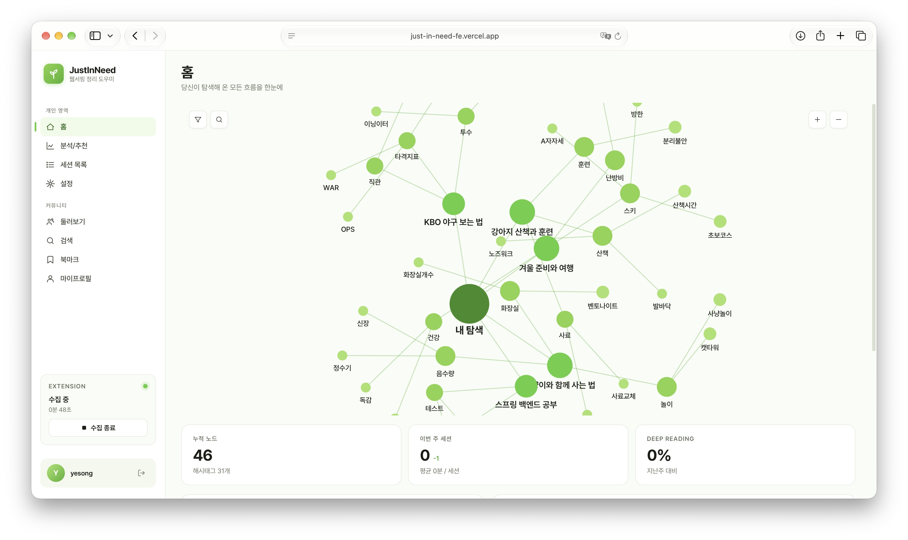
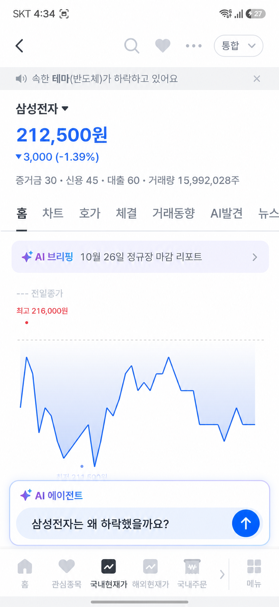
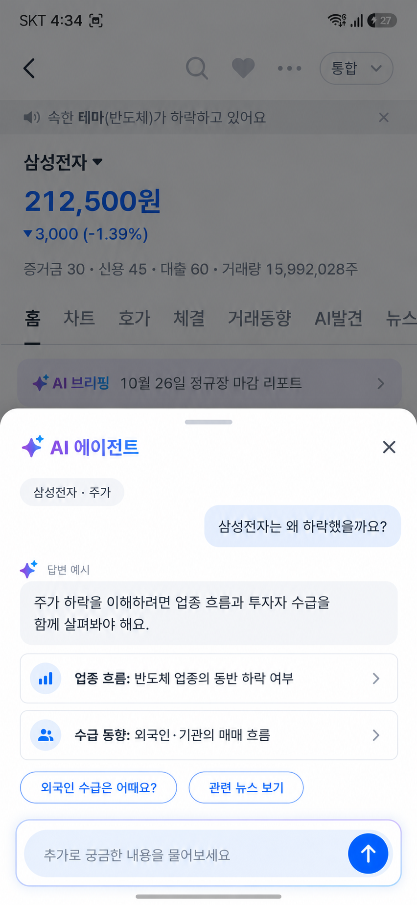

# 이찬종 | 금융 IT 백엔드 개발 포트폴리오

웹 탐색 기록을 모아 분석을 요청하는 **JustInNeed의 Spring Boot 백엔드**와, 투자자가 보고 있는 증권 화면에서 질문을 제안하는 **All in WON의 질문 Agent**를 개발했습니다. 두 프로젝트에서 공통으로 다룬 문제는 ‘이 결과가 어느 사용자의 어떤 요청에서 나왔는가’였습니다. 웹 탐색에서는 여러 번 나뉘어 도착한 기록을 하나의 세션으로 묶어야 했고, 증권 앱에서는 사용자가 질문을 누른 뒤에도 그 질문을 만든 종목과 공시를 식별할 수 있어야 했습니다.

금융 IT 백엔드 개발에 관심이 있습니다. 뉴스와 주가를 연결할 때는 어느 시점의 정보인지, 불법 거래를 탐지할 때는 어느 집단에서 모델이 틀리는지를 분석했습니다. 이런 경험을 바탕으로 서버가 분석 결과를 받아 화면에 전달할 때도 입력 데이터의 시점, 출처, 적용 범위를 함께 살펴봅니다.

## 프로젝트 한눈에 보기

| 프로젝트 | 내가 맡은 일 | 확인할 수 있는 결과 |
|---|---|---|
| [01 · JustInNeed](#project-01) | Spring Boot 백엔드 개발 전반 · 회원 인증, 세션 기록 저장, AI 분석 연동, 결과 조회 | 탐색 세션의 요약·마인드맵에서 원문으로 돌아가는 흐름 |
| [02 · All in WON](#project-02) | 서비스 기획, 질문 Agent 개발, 금융용어 DB 구축, 영상 제작·발표 | 종목 화면과 금융 이해도에 따라 바뀌는 추천 질문 |
| [03 · 국내 방산주 주가 예측](#project-03) | 팀장, 데이터 수집·전처리, 거래일 정렬, 파생변수 설계, TCN 학습·검증 | 뉴스·SNS 입력 조합 비교, MATRIX FINAL CONFERENCE 최우수상 |
| [04 · 비트코인 AML](#project-04) | RF·GCN 재현, 클래스 가중치·시간 정보 실험, 성능 하락 구간 분석 | 소수 클래스 F1의 개선 폭과 RF 비교 결과 |
| [05 · Machine Unlearning](#project-05) | SISA 논문 분석, 보고서 작성, 공동 발표 | 데이터 삭제 후 재학습 범위와 비용을 설명한 보고서 |

## 01. JustInNeed | 읽기 기록을 요약으로 돌려주는 백엔드

여러 페이지를 읽은 뒤 북마크를 다시 열어도, 정작 필요했던 설명이 어느 문단에 있었는지는 찾기 어렵습니다. 3인 졸업프로젝트 JustInNeed는 Chrome 확장 프로그램으로 읽기 행동을 기록하고, 관심을 보인 문단을 줄글과 마인드맵으로 정리해 원문에 연결합니다.

**저는 Spring Boot 백엔드 개발 전반을 맡았습니다.** 회원 인증과 확장 프로그램 계정 연결을 처리하고, 확장이 여러 번에 나눠 보낸 읽기 기록을 세션별로 PostgreSQL에 저장했습니다. 세션이 끝나면 해당 기록을 모아 AI 서버에 분석을 요청하고, 반환된 요약과 마인드맵을 저장해 사용자가 웹에서 다시 열어 볼 수 있도록 조회 API를 개발했습니다.

*팀 최종 발표자료에 수록된 홈 화면. 여러 탐색 세션의 주제를 마인드맵에서 다시 살펴볼 수 있습니다.*

### 세션 한 건이 만들어지는 과정

| 시점 | 오가는 데이터와 서버의 역할 |
|---|---|
| 수집 시작 | 확장이 시작 기록을 첫 조각으로 즉시 보냅니다. 첫 조각을 받은 시점부터 웹에서 수집 중인 세션을 표시할 수 있습니다. |
| 탐색 중 | 확장은 기본 30초마다 `POST /sessions/chunks`로 기록을 보냅니다. 요청에는 세션을 구별하는 `sessionId`, 조각 순서를 나타내는 `n`, 문단과 행동 기록이 들어갑니다. Spring 서버는 받은 기록을 DB에 저장합니다. |
| 수집 종료 | 마지막 조각에는 `final`과 마지막 번호 `maxN`이 담깁니다. Spring 서버는 한 세션의 기록을 모아 내부 AI 서버에 분석을 요청합니다. |
| 결과 조회 | AI 서버가 선별한 문단으로 요약과 마인드맵을 만들면 Spring 서버가 결과를 저장합니다. 사용자는 웹의 세션 목록에서 결과를 열고 원문 출처로 돌아갑니다. |

수집과 분석의 단위가 다르다는 점이 중요했습니다. 확장은 읽는 동안 생긴 작은 기록을 계속 보내지만, 분석에는 여러 페이지에 걸친 한 세션의 순서가 필요합니다. 세션 ID와 조각 번호를 함께 보내면 같은 세션에 속한 기록과 그 순서를 구별할 수 있습니다. 요청 필드와 마지막 조각을 만드는 코드는 서비스용 확장 프로그램의 `bg-sink.js`에서 확인할 수 있습니다. [확장 프로그램 소스 ZIP](./HCI%20기반%20사용자%20웹서핑행동%20요약%20서비스%20프로젝트/justinneed-service-0.3.1.zip)

### 팀이 해결한 두 가지 연동 문제

**웹과 확장 프로그램에서 동시에 로그인을 갱신하는 문제.** 두 환경이 같은 일회용 갱신 토큰을 사용하면 먼저 처리된 요청 때문에 다른 쪽이 실패할 수 있습니다. 팀은 웹에서 일회용 연결 코드를 발급하고 확장이 이를 전용 토큰으로 교환하도록 구성했습니다. 확장 안에서 여러 호출이 동시에 갱신을 요청하면 하나의 재발급 결과를 함께 기다립니다. 이 동작은 `bg-auth.js`와 최종 발표자료의 인증 사례에 남아 있습니다.

**전송이 끊겼을 때 어디서 이어갈지 결정하는 문제.** 브라우저가 닫히거나 서비스 워커가 중단될 수 있어, 팀은 기록 수집과 서버 전송을 분리했습니다. 확장은 전송할 조각과 진행 상태를 로컬에 함께 저장하고, 전송에 실패한 조각을 보관했다가 같은 세션 안에서 순서대로 재시도합니다. 서버와 클라이언트가 주고받는 데이터 형식은 현재 확장 소스에서 확인할 수 있습니다. 서버 내부의 개별 메서드는 이 압축본에 포함되어 있지 않습니다.

### AI와 배포가 백엔드에 연결되는 방식

문단 길이가 다르면 같은 10초도 다르게 해석해야 합니다. 팀은 일반 본문을 문장 경계에 맞춰 약 200자 단위로 나누고, 체류 시간·재방문·스크롤 같은 행동으로 읽기 상태를 추정했습니다. AI 서버는 읽었다고 분류한 문단에서 중복 내용을 합쳐 요약과 마인드맵을 만듭니다. 오래 머문 곳과 실제로 유용했던 곳이 일치하는지는 사용자 평가로 확인할 과제입니다.

팀 배포 환경에서 Spring Boot와 FastAPI는 한 AWS EC2의 별도 Docker 컨테이너로 동작합니다. 확장과 웹은 Spring 서버에 요청하고 Spring이 내부 AI 서버를 호출합니다. 데이터는 Supabase의 PostgreSQL에 저장하고, 웹은 Vercel에서 제공합니다. GitHub Actions가 이미지를 빌드해 Docker Hub에 올리면 EC2가 받아 실행하는 구조입니다. [시스템 구성·문제 해결 발표자료](./HCI%20기반%20사용자%20웹서핑행동%20요약%20서비스%20프로젝트/JustInNeed_최종발표.html) · [서비스 시연 영상](./HCI%20기반%20사용자%20웹서핑행동%20요약%20서비스%20프로젝트/프로젝트%20소개영상.mp4) · [프로젝트 README](./HCI%20기반%20사용자%20웹서핑행동%20요약%20서비스%20프로젝트/README.md)

## 02. All in WON | 증권 화면에서 먼저 질문하는 금융 AI

증권 앱에서 공시를 읽다가 낯선 용어를 만나면, 초보 투자자는 AI 메뉴를 찾고도 첫 질문을 쓰기 어렵습니다. 우리 WON 청년 IT 아카데미 AX 해커톤에서 4명이 2박 3일 동안 **종목 화면에 먼저 질문을 띄우고, 선택하면 같은 화면에서 설명하는 시제품**을 만들었습니다. 저는 팀의 기획과 범위 조율, 질문·답변 Agent 구조 설계, **Spring AI 질문 Agent 개발**, MySQL 금융용어 DB 구축, 소개영상 제작과 최종 발표를 맡았습니다.

| 질문 추천 | 답변 확인 |
|---|---|
|  |  |

### 어떤 질문을 만들지 결정한 기준

같은 종목이라도 차트를 보는 사람과 공시를 보는 사람이 궁금해하는 내용은 다릅니다. 그래서 질문 Agent의 입력을 **현재 보고 있는 콘텐츠**와 **사용자가 고른 금융 이해도**로 나눴습니다. 차트에서는 가격·거래량과 조회 기간을, 공시에서는 제목과 식별 정보를 사용합니다. 쉬운 질문에서 깊은 질문으로 바꾸면 같은 공시를 두고도 기본 개념을 물을지, 관련 정보의 의미를 물을지가 달라집니다.

저는 질문 Agent를 개발하면서 화면 정보를 어떤 단위로 넘길지와 질문을 선택한 뒤 무엇을 유지해야 할지를 함께 다뤘습니다. 질문을 만든 뒤 사용자가 다른 기사로 스크롤하면 ‘이 뉴스’라는 표현이 가리키는 대상이 바뀔 수 있습니다. 팀 설계에서는 질문을 만들 당시의 종목·콘텐츠·이해도를 묶어 두고, 선택 시 질문 ID와 세션 ID로 그때의 맥락을 찾도록 했습니다. 이 식별 방식은 설계 문서에서, 질문 카드와 답변 패널 전환은 데모에서 확인할 수 있습니다. [설계와 시제품 범위](./AX%20해커톤%20프로젝트/All_in_WON_GitHub_README.md) · [데모 화면 소스 ZIP](./AX%20해커톤%20프로젝트/demo%20파일.zip)

### 금융 데이터를 답변의 근거로 연결하기

질문 추천은 화면 정보만으로 시작할 수 있지만 답변을 작성하려면 질문에 맞는 근거가 필요합니다. 팀의 답변 흐름은 선택한 질문에 따라 종목·시장 정보는 증권 API에서, 뉴스·공시·용어는 DB에서 조회하도록 설계했습니다. 제가 구축한 금융용어 DB는 같은 용어를 여러 화면에서 다시 설명할 때 참조하는 자료입니다. 용어사전 설계에는 용어 코드, 별칭, 쉬운 설명과 상세 설명, 출처가 포함됩니다.

해커톤에서는 우리금융지주 한 종목을 중심으로 시연 범위를 잡았습니다. 제가 맡은 최종 발표에서는 차트를 보다가 공시로 이동하고 이해도를 바꿔 질문을 고른 뒤 답변을 확인하는 장면을 보여주는 순서로 구성했습니다. 시제품으로 확인한 결과는 이 흐름이며, 질문 선택률과 답변 유용성은 후속 검증 항목입니다. 민감한 질문을 현업 담당자가 검토하는 절차도 고도화 계획에 포함했습니다. [발표 대본](./AX%20해커톤%20프로젝트/발표대본.pdf) · [서비스 소개영상](./AX%20해커톤%20프로젝트/서비스소개영상.mp4)

## 03. 국내 방산주 주가 예측 | 뉴스 한 건을 어느 거래일에 넣을 것인가

한화에어로스페이스·현대로템·LIG넥스원의 다음 거래일 주가 방향을 예측할 때, 한국어 뉴스와 투자 커뮤니티의 반응을 함께 쓰면 어떤 차이가 생기는지 실험했습니다. 저는 팀장으로 기획, 데이터 수집·전처리, 감성 모델 선정, 파생변수 설계, TCN 학습·검증을 맡았습니다. 팀은 이 프로젝트로 **2026년 2월 MATRIX FINAL CONFERENCE 최우수상**을 받았습니다.

**제가 정한 데이터 결합 기준.** 달력 날짜로만 데이터를 합치면 장이 끝난 뒤 나온 기사가 이미 결정된 당일 종가에 대응됩니다. 이전 거래일 종가 이후부터 당일 종가 전까지의 뉴스·게시글을 당일 가격 데이터와 연결하고, 마감 이후 정보는 다음 영업일로 넘기는 기준을 세웠습니다. 데이터 수집 단계에서는 네이버 종목토론방의 과거 자료 확보가 어려워 팀이 수집처를 변경했습니다. 이 변경으로 확보한 커뮤니티 표본의 양과 범위가 제한됐습니다.

**제가 맡은 모델 실험.** GPT-4o mini와 KR-FinBERT의 감성 라벨을 긍정·중립·부정으로 맞추고, 가격 수준이 다른 종목을 비교하기 위해 정배열 지수·장기 이격도·이평선 수렴도 같은 관계를 변수로 표현했습니다. 제가 학습·검증한 TCN은 최근 5거래일의 데이터를 입력으로 다음 날 변동률을 예측했습니다. 팀은 XGBoost와 CNN-LSTM도 함께 비교했습니다.

| 팀 실험의 입력 조건 | 방향 적중률 |
|---|---:|
| 기술적 지표 | 49.67% |
| 기술적 지표 + 뉴스 | 48.69% |
| 기술적 지표 + SNS | 49.56% |
| 기술적 지표 + 뉴스 + SNS | **52.95%** |

각 자료를 하나만 더했을 때는 기준선보다 낮았고, 둘을 함께 쓴 조건은 **3.28%p** 높았습니다. 이 표는 팀의 입력 조합 비교이며 해당 그래프의 모델명과 평가 분할은 미확인입니다. 별도 실험에서 팀이 보합을 먼저 거르고 방향을 예측하자 최종 3개 범주의 MCC는 0.4096이었지만, 방향만 예측한 단계의 MCC는 −0.0626이었습니다. 전체 점수가 좋아져도 어느 단계가 기여했는지를 따로 확인해야 한다는 점을 배웠습니다. [입력 조합 비교와 2단계 결과, 15–16쪽](./주가예측%20프로젝트/뉴스%20및%20SNS%20데이터를%20활용한%20주가예측%20프로젝트_PPT.pdf#page=15) · [프로젝트 README](./주가예측%20프로젝트/README.md)

## 04. 비트코인 AML | 드문 불법 거래를 놓치는 조건 분석

Elliptic 데이터에서 불법으로 표시된 거래는 전체의 약 2%입니다. 팀은 거래 자체의 특성을 사용하는 Random Forest(RF)와 거래 사이 자금 흐름도 학습하는 그래프 신경망(GCN)을 재현했습니다. 저는 Python으로 두 모델을 비교하고, 불법 거래에 부여하는 손실 가중치와 시간 정보를 바꿔 어떤 조건에서 탐지 성능이 떨어지는지 분석했습니다.

**실험 설계.** 드문 불법 거래를 얼마나 찾아내는지 보기 위해 해당 클래스의 정밀도와 재현율을 함께 반영하는 Illicit F1을 봤습니다. GCN 구조를 고정한 상태에서 가중 교차엔트로피와 Focal Loss를 포함한 6개 설정을 각각 3개 시드로 반복했습니다.

| 합법·불법 거래의 손실 가중치 | 평균 Illicit F1 | 시드 간 표준편차 |
|---|---:|---:|
| 0.5 · 0.5 | 0.461 | 0.042 |
| 0.3 · 0.7 | 0.610 | 0.028 |
| 0.2 · 0.8 | **0.642** | 0.005 |

동일 가중치에서 불법 거래 가중치를 높였을 때 평균 F1은 **0.181 상승**했습니다. 기준값 대비 약 39.3% 개선입니다. 별도의 최종 모델 비교에서는 RF가 0.806으로 가장 높았고, 시간에 따라 가중치를 갱신하는 EvolveGCN은 0.626이었습니다. 여러 모델이 43번째 시점에서 함께 흔들렸다는 점도 확인했습니다. 이 결과를 해석할 때 모델 구조에 더해 거래 간 연결의 희소성과 시점별 데이터 분포 변화를 살폈습니다. [가중치 실험, 10–12쪽](./AML%20프로젝트/기학심%20발표.pdf#page=10) · [모델별 결과와 하락 구간, 15–17쪽](./AML%20프로젝트/기학심%20발표.pdf#page=15) · [프로젝트 README](./AML%20프로젝트/README.md)

## 05. Machine Unlearning | 삭제 요청 한 건의 재학습 비용

학습에 사용한 데이터를 삭제하면 원본 파일은 사라져도 모델 파라미터에는 그 영향이 남습니다. 저는 기존 방법의 한계와 SISA 학습 구조를 조사해 **개인 분석 보고서를 작성하고 2인 공동 발표**에 참여했습니다.

SISA는 데이터를 여러 묶음으로 나누고 묶음마다 독립된 모델을 학습합니다. 각 묶음 안에서도 데이터를 순차적으로 추가하며 중간 상태를 저장합니다. 삭제 요청이 들어오면 해당 데이터가 속한 묶음에서, 그 데이터를 처음 학습하기 직전 상태로 돌아가 다시 학습할 수 있습니다.

보고서에서는 어디까지 잘게 나누는 것이 유리한지 살펴봤습니다. 논문 실험에서 묶음을 늘리면 삭제 한 건에 필요한 재학습량은 줄었지만, 복잡한 이미지 분류에서는 개별 모델이 학습할 데이터가 줄면서 정확도 손실이 커졌습니다. 체크포인트를 자주 남기면 이전 계산을 더 많이 재사용할 수 있는 대신 저장 공간이 더 필요합니다. 이 프로젝트의 산출물은 그 상충관계를 분석한 보고서와 발표입니다. [개인 보고서](./Machine%20Unlearning%20프로젝트/Machine%20Unlearning_보고서_C111143%20이찬종.pdf) · [공동 발표자료](./Machine%20Unlearning%20프로젝트/Machine%20Unlearning_발표자료_C111143%20이찬종.pdf) · [프로젝트 README](./Machine%20Unlearning%20프로젝트/README.md)

## 교육·자격과 다음 과제

- **우리 WON 청년 IT 아카데미**에서 계정계·정보계·채널계의 역할과 금융 데이터가 생성·적재·활용되는 흐름을 학습했습니다. AX 해커톤에서는 그중 고객이 이용하는 채널을 대상으로 증권 화면의 정보와 AI 추천 질문을 연결했습니다.
- **정보처리기사 · SQL 개발자(SQLD)** 자격을 보유하고 있습니다. 프로젝트에서는 MySQL을 금융용어 조회에, PostgreSQL을 웹 탐색 세션 저장에 활용했습니다. [기존 포트폴리오의 교육·자격·수상 기록](./이찬종_포트폴리오.pdf#page=1)
- **다음 백엔드 과제**는 요청 한 건을 끝까지 추적할 수 있게 만드는 것입니다. JustInNeed에서는 마지막 조각이 늦게 오거나 중복 전송될 때의 저장·분석 결과를, All in WON에서는 한 질문의 화면 정보와 도구 조회 결과 및 응답 시간을 함께 기록해 확인하고 싶습니다.
